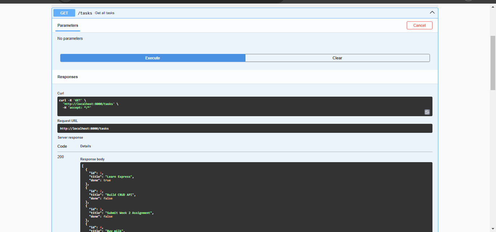

# Task API

A simple RESTful CRUD API built with Node.js and Express as part of the FlyRank Backend AI Engineering Internship (Week 2 Assignment).

## Features

- Create a new task
- Get all tasks
- Get a single task by ID
- Update a task
- Delete a task
- Input validation
- Health check endpoint
- Interactive API documentation with Swagger UI

## Technologies Used

- Node.js
- Express.js
- Swagger UI Express
- OpenAPI 3.0

## Installation

Clone the repository:

```bash
git clone https://github.com/Husinat/flyrank-backend-intern-week-2-crud-api-.git
```

Navigate into the project:

```bash
cd Week-02-Crud-Api
```

Install dependencies:

```bash
npm install
```

## Running the Project

Development mode:

```bash
npm run dev
```

Production mode:

```bash
npm start
```

The server runs on:

```
http://localhost:5000
```

Swagger documentation:

```
http://localhost:5000/docs
```

The following endpoints are available:

## API Endpoints

| Method | Endpoint | Description |
|---------|----------|-------------|
| GET | / | API information |
| GET | /health | Health check |
| GET | /tasks | Get all tasks |
| GET | /tasks/:id | Get one task |
| POST | /tasks | Create a task |
| PUT | /tasks/:id | Update a task |
| DELETE | /tasks/:id | Delete a task |

## Example Request

```bash
curl -i http://localhost:5000/tasks
```

Example response:

```json
[
  {
    "id": 1,
    "title": "Learn Express",
    "done": false
  }
]
```

## Swagger UI

The API includes interactive documentation powered by Swagger UI.

Open:

```
http://localhost:5000/docs
```

and use the **Try it out** button to test every endpoint.

### Swagger Preview



## Project Structure

```
Week-02-Crud-Api/
│── index.js
│── openapi.json
│── package.json
│── README.md
│── .gitignore
```

## Learning Outcomes

Through this project, I learned how to:

- Build RESTful APIs using Express.js
- Implement CRUD operations
- Validate incoming request data
- Return appropriate HTTP status codes
- Document APIs with Swagger UI
- Test APIs using curl and Swagger
- Manage project versions using Git and GitHub


## Author

**Husinat Azeez Abiodun**

Built as part of the FlyRank Backend AI Engineering Internship – Week 2: Build Your First CRUD API.