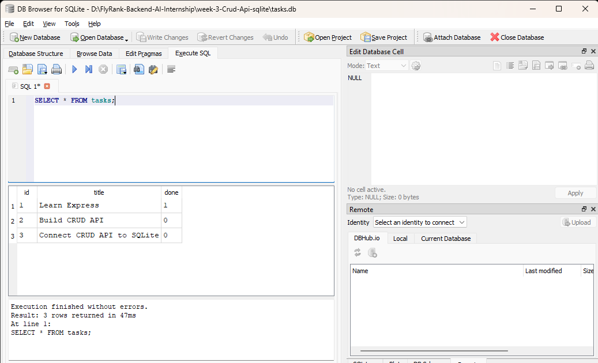

# Task API — SQLite

This project builds on the CRUD API from Week 2 by replacing in-memory task storage with a persistent SQLite database. The API endpoints remain the same, but tasks now survive server restarts.

## Features
Create a new task
Get all tasks
Get a single task by ID
Update a task
Delete a task
Input validation
Appropriate HTTP status codes
Health check endpoint
Persistent SQLite database
Automatic database and table creation
Starter tasks inserted only when the database is empty
Interactive API documentation with Swagger UI


## Technologies Used
Node.js
Express.js
SQLite
better-sqlite3
Swagger UI Express
OpenAPI 3.0
cURL


## How It Works

The Week 2 version stored tasks in an in-memory JavaScript array:

Client → Express API → In-memory array

In this version, the storage layer has been replaced with SQLite:

Client → Express API → SQLite database

The API endpoints remain unchanged. The main difference is that the data now persists when the server restarts.

## Installation

Clone the repository:

```bash
git clone https://github.com/Husinat/flyrank-backend-intern-week-3-crud-api-sqlite.git
```

Navigate into the project:

```bash
cd Week-03-Crud-Api-sqlite
```

Install dependencies:

```bash
npm install
```

## Running the Project

Development mode:

```bash
npm run dev
```

Production mode:

```bash
npm start
```

The server runs on:

```
http://localhost:5000
```

Swagger documentation:

http://localhost:5000/docs

The SQLite database is automatically created as:

tasks.db

in the project root.

The tasks table is also created automatically when the application starts if it does not already exist.


## API Endpoints

| Method | Endpoint | Description |
|---------|----------|-------------|
| GET | / | API information |
| GET | /health | Health check |
| GET | /tasks | Get all tasks |
| GET | /tasks/:id | Get one task |
| POST | /tasks | Create a task |
| PUT | /tasks/:id | Update a task |
| DELETE | /tasks/:id | Delete a task |

## Example Request

```bash
curl -i http://localhost:5000/tasks
```

Example response:

[
  {
    "id": 1,
    "title": "Learn Express",
    "done": 1
  },
  {
    "id": 2,
    "title": "Build CRUD API",
    "done": 0
  }
]

```

## Database

SQLite was chosen because it is lightweight, requires no separate database server, and is suitable for learning database fundamentals while keeping the project simple.

The database file is:

tasks.db

The database contains a tasks table with:

Column	Type	Description
|---------|----------|-------------|
id |	INTEGER	| Primary key
title |	TEXT |	Task title
done |	BOOLEAN |	Completion status

Starter tasks are inserted automatically only when the table is empty.


SQL Exploration

During this assignment, I also interacted directly with the SQLite database using DB Browser for SQLite.

Example query:

SELECT * FROM tasks WHERE done = 1;

This query returns only completed tasks.

Another query used during the assignment was:

SELECT COUNT(*) FROM tasks;

which returns the total number of tasks stored in the database.


### Database Preview




## Swagger UI

The API includes interactive documentation powered by Swagger UI.

Open:

```
http://localhost:5000/docs
```

The Try it out feature can be used to test the CRUD endpoints directly.


### Swagger Preview


Project Structure
week-3-Crud-Api-sqlite/
│
├── database/
│   └── db.js
│
├── images/
│   └── swagger-ui.png
│   └── sqlite-database.png
│
├── node_modules/
├── tasks.db
├── index.js
├── openapi.json
├── package.json
├── package-lock.json
├── README.md
└── .gitignore


## Learning Outcomes

Through this project, I learned how to:

- Build RESTful APIs using Express.js
- Connect an Express API to a SQLite database
- Replace in-memory storage with persistent storage
- Create and query SQLite tables using SQL
- Perform CRUD operations using SQL queries
- Understand the separation between the API layer and data layer
- Verify that data persists after server restarts
- Use SQL SELECT, WHERE, COUNT, UPDATE, and DELETE
- Inspect and modify a database using DB Browser for SQLite
- Continue using Swagger UI and cURL to test the API
- Document a backend project professionally


Author

Husinat Azeez Abiodun

Built as part of the FlyRank Backend AI Engineering Internship — Week 3: Connecting Your CRUD API to a Database.